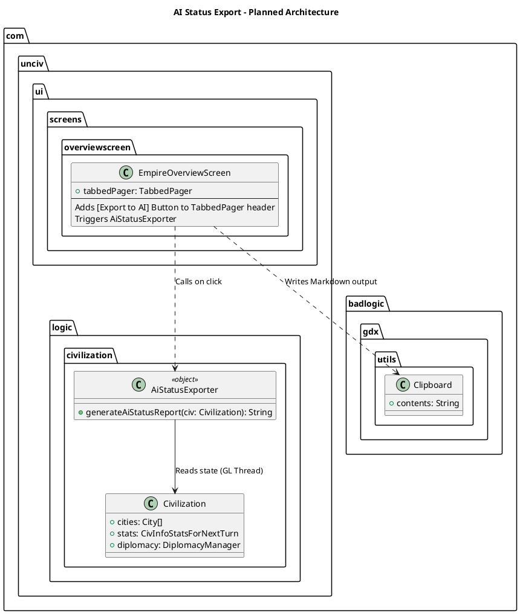

# 🚀 Context Transfer: Unciv AI Status Export

## 📍 Where We Are (Status)

* **Current Phase:** UNCIV-1-01-01 (Planning completed)
* **Last Completed:** Wrote and refined the `implementation_plan.md` based on code structure (`GameInfo`, UI insertion), and wrote the plan to `.doc/`.
* **In Progress:** Transitioning to Execution phase.
* **Next Up:** Implement `AiStatusExporter` and modify `EmpireOverviewScreen` to add the export button.

## 📝 Task Status (`task.md` Snapshot)

```markdown
# Tasks

- [ ] Planning
  - [x] Research Unciv codebase (Clipboard interaction, `GameInfo` structure, UI insertion point)
  - [x] Write `implementation_plan.md` conforming to user strict guidelines (Version header, English only, Kotlin best practices)
  - [x] Request user review
- [ ] Execution
  - [ ] Implement AI status exporter
  - [ ] Add UI trigger to export report to clipboard
- [ ] Verification
  - [ ] Verify functionality
```

## 🧠 Key Context & Decisions

* **Frameworks:** Kotlin, LibGDX (Unciv architecture).
* **Recent Changes:** The implementation plan is complete and saved to `.doc/PLAN--UNCIV-1-01-01--AI-Status-Export.md`.
* **Key Decisions:**
  * Logic isolated to `object AiStatusExporter.generateAiStatusReport(civ)`.
  * Stats MUST be accessed on the GL Thread.
  * Button to trigger export is added to the `TabbedPager` header area in `EmpireOverviewScreen.kt` so it doesn't break the stat table layout.
  * Spectators explicitly generate a "no data" string.
* **Active Rules:**
  * `GUIDE--plan-versioning-core.md` (English only, version tracking).
  * Kotlin Android Development Instructions (No `.let`, clean SOLID, composition overlay).

## 📂 Hot Files (To Open First)

* `c:\Git\Unciv\.doc\PLAN--UNCIV-1-01-01--AI-Status-Export.md`
* `c:\Git\Unciv\core\src\com\unciv\ui\screens\overviewscreen\EmpireOverviewScreen.kt`
* `c:\Git\Unciv\core\src\com\unciv\logic\civilization\AiStatusExporter.kt` (To be created)

## 🏗️ Visualization (Current State)



## ⏭️ Prompt for Next Session

*(Copy and paste this into the new chat)*

> "I am continuing work on UNCIV-1-01-01 (AI Status Export). We just completed the Planning phase and wrote the implementation plan. We are ready to start Execution.
> Please review the attached `task.md` and the 'Hot Files' listed above.
>
> **Immediate Goal:** Implement the `AiStatusExporter.kt` object and add the UI button to `EmpireOverviewScreen.kt`."
