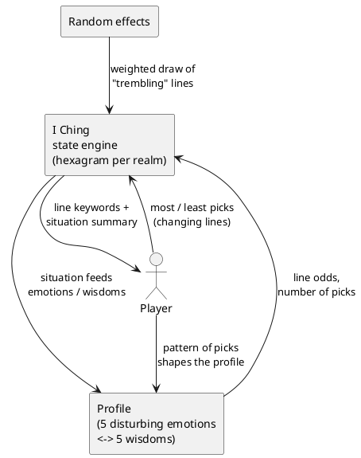
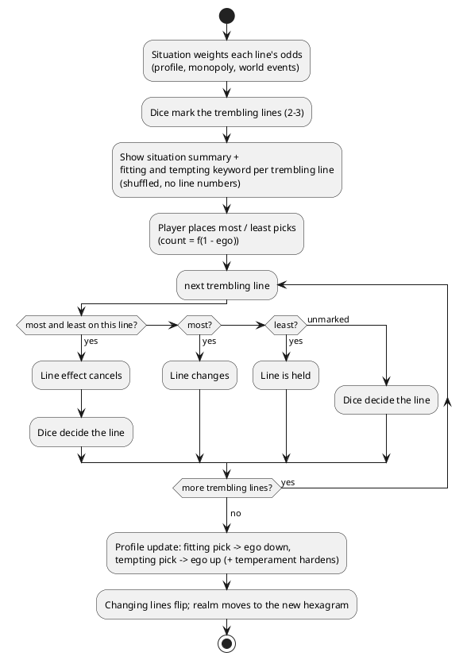
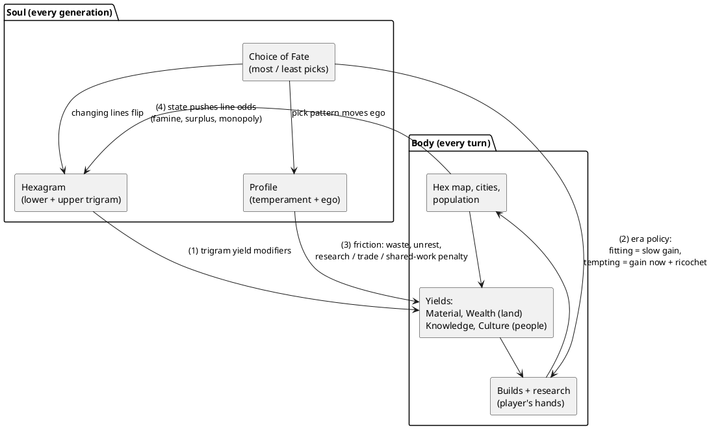

# SYNTROPY — Brainstorming Base

> Living document for the game-design brainstorming. **No implementation code** until the user says so.
> Source of everything marked *canon*: the original Perplexity brainstorming session (undated, pre-2026-11). The raw transcript was deleted on 2026-11-17; **this document is now the canon**.
> Each session: read this file → work one agenda item → update §3 Decisions, §5 Questions, §9 Log.

---

## 1. Vision (one breath)

A turn-based, top-down, tribe-to-civilization game where **nobody wins**. The goal is the **flow state** of whoever plays (and of whoever builds it). Evolution is **social and mental, not biological**. The world state is an **I Ching hexagram**: each turn a *changing line*, picked through plain-language keywords, moves the realm into a new hexagram. LLMs play the other realms, and they also **invent new concepts** (technologies, customs). The game's own deterministic laws put a price on everything they invent.

Philosophy underneath: *everything is one mind's appearance, so everything is good.* No ego-feeding, no monetization pressure. The builder's reward is the flow of building it.

## 2. Pillars

| # | Pillar | One-line meaning |
|---|---|---|
| P1 | **Communication** | Knowledge travels and distorts; it is not broadcast. |
| P2 | **Evolution** | Social/mental/cultural patterns unfold; extremes flip into their opposites. |
| P3 | **Feedback** | Choices echo across generations (trauma, learning, cultural memory). |
| P4 | **Strength in cooperation** | Alone is slow; together is fast but costs coordination. |
| P5 | **Flow** *(meta-pillar)* | Every mechanic is judged by whether it helps or breaks flow. |

## 3. Settled decisions (canon)

| ID | Decision | Notes |
|---|---|---|
| D-01 | Turn-based, top-down map, human tribe → civilization. | Civ is the reference genre, not a template. |
| D-02 | No winning. Emergence and a **Journal** (auto-chronicle) take its place. | Revised 2026-11-17: there **is** one fail condition, see D-19. |
| D-03 | Evolution is social/mental, not biological. **Religion is emergent, not a menu item**: no built-in religion mechanic, but belief systems may emerge from concepts. | Revised 2026-11-17. Rationale: in Civ every religion is the same buff package with a different name. What really moves people is the **ego illusion**; religion is one of its group-scale forms. See D-16, Q-21. |
| D-04 | ~~Engine: **Unity C#**~~, Windows first, Android tablet maybe later. | ⚠ Engine superseded by D-41 (Unciv fork, Kotlin); C# is dropped. Platform order stays. Repo `CLAUDE.md` tech stack filled in on 2026-11-17 (Kotlin, Gradle, Unciv modules). |
| D-05 | **LLM players** via Markdown: game emits `STATE.md`, LLM returns `RESPONSE.md`. | ⚠ Superseded for rivals by D-28 (coded rivals) and for the human side by D-29 (one-way advisor). |
| D-06 | **Manual Bridge** first: the human copy-pastes/drag-drops between game and chat. No API. | Bridge = ritual. Revised by D-29: the bridge is now **one-way** (game → player's own LLM project) and optional. Still no API. |
| D-07 | LLM rules live in a doc set: `SYSTEM_CORE.md`, `PROTOCOL_RESPONSE.md`, `WORLD_LOGIC.md`, `EVOLUTION_LIBRARY.md`. | ⚠ Revised by D-29: the doc set becomes the **advisor kit**. `PROTOCOL_RESPONSE.md` is obsolete: the bridge is one-way, there is no `RESPONSE.md`. |
| D-08 | **I Ching hexagram = realm state.** Every realm has one. Player picks the changing line via keywords ("Choice of Fate"). | Player never needs to know it's I Ching. |
| D-09 | **Trigrams = passive buffs** (upper + lower trigram → two traits). | |
| D-10 | Determinism is **fractal**: same rules at every scale; same choice → same hexagram. | Refined by D-20, D-21: the *rules* are deterministic, the *dice* are not (outside tests). |
| D-11 | Four resources: **Material, Wealth, Knowledge, Culture.** | |
| D-12 | **Valuation Engine** (own Kotlin code per D-41, deterministic) prices LLM-invented concepts from their **tags**; LLM never sets costs. | Balance stays in code. |
| D-13 | **Auto-Governor** executes the micro-management (builds, improvements) based on the chosen keyword/direction. | "Gardener" play style. ⚠ Deferred by D-38 (hands-on play first). |
| D-14 | Name: **SYNTROPY: Order from Chaos.** | The runner-up name was *Flux*, also the name of the former design repo (merged into the Unciv fork on 2026-11-17, see §9). |
| D-15 | **RPG elements are back in.** They were in the original request and dropped silently during the I Ching / Auto-Governor sessions. | 2026-11-17. *What* RPG means here is still open: Q-22. |
| D-16 | The **ego illusion** (sense of a separate self) is a core driving force of people in the game, stronger than religion. | 2026-11-17. How it becomes a mechanic: Q-21. |
| D-17 | The ego illusion shows up as **disturbing emotions**, at the individual level *and* at the group level (**group disturbing emotions**, the user's term). They are the **main antagonist force against cooperation (P4)**. | 2026-11-17. **Never named in the game**: the player only sees the emergent phenomena (feuds, hoarding, dogma, refusing a neighbour's know-how). Candidate set and transformation: Q-23. |
| D-18 | **Institutions are wisdom deflected by ego, not institutionalized poison.** Every force (army, trade, law, belief) has a wise core; the individual/group ego gives it a ricochet. Example: an army's core is peace-keeping (deterrence, balance of power, cf. the Cold War); deflected, it becomes conquest. | 2026-11-17. Explicitly **against** David Loy's reading (§8). The poison is a **raw material the player uses**, not an enemy to eliminate. |
| D-19 | **Fail condition: monopolization.** The weak get swept away and the remaining superpower turns dictatorial/monopolistic. The player's job is to decide how to use the poison: let monopolization happen, or keep it in check. | 2026-11-17. Fits Carse: the infinite game only "ends" when someone wins it. **Not a game over** (Q-24 → B, 2026-11-17): the hegemon falls into a heavy **Standstill** state (hexagram 12 as candidate) that can only be left through **collapse**, as empires do. The game continues after the fall. |
| D-20 | **"Same seed + same choices (+ same stored LLM responses) = same run"** holds for **testing/replay only**. The real game may be random (fresh seed). | 2026-11-17. The engine must still *support* a fixed seed so tests and bug replays are exact. Links Q-17. |
| D-21 | **Hexagram changes are weighted, not uniform.** The situation raises the odds of certain hexagrams (e.g. dictatorship/monopoly → Standstill). Changing lines may be random **and/or** chosen by the player. | 2026-11-17. Mechanism still open: Q-26. |
| D-22 | **Choice of Fate, v2:** the player receives the hexagram as **line keywords + a situation summary**, and picks several of them in a **"most / least" (DISC-like forced choice)** way. **How many** they may pick depends on **flexibility stats**. | 2026-11-17. Working reading: "most" = that line changes, "least" = that line is held this turn. Supersedes the "pick one keyword" loop in §4. Refined by D-34 (trembling lines, two keywords each) and D-35 (same-line cancel). |
| D-23 | **Hidden profile from choices.** The pattern of the player's picks builds a profile the player never sees as numbers. The profile feeds back: it influences **how many changing lines** can be chosen (and possibly the line odds of D-21). | 2026-11-17. Strong RPG link (Q-22). Dimensions and feedback balance: Q-27. |
| D-24 | **The core formula.** (1) The **I Ching** is the game's **state engine**: non-negotiable. (2) The **disturbing emotions / wisdoms** form the **player profile**. (3) The game *is* the **interplay of these two + random effects + player interaction**. | 2026-11-17. Answers the axes part of Q-27: profile = 5 disturbing emotions ↔ 5 wisdoms (inner structure: D-31). Everything else (resources, Valuation Engine, Auto-Governor, LLM realms) serves this core. See §4 "Core engine". |
| D-25 | **One rule system: world events push lines.** Random effects include world events (drought, plague, a stranger arriving), but every event is expressed as a push on hexagram lines / line odds. No second rulebook beside the I Ching engine. | 2026-11-17. Resolves Q-28. |
| D-26 | **Same engine, same profile, two kinds of minds.** Every realm has a profile. Other players are embodied by **LLMs with different profiles**. The human player(s) may ask an **LLM advisor** for help with their own choices. | 2026-11-17. Resolves Q-29, mostly answers Q-02. "Player(s)" leaves room for more than one human. Follow-ups: Q-30. ⚠ The "LLMs embody the other players" part is superseded by D-28: rivals are code with profiles, not live LLMs. The one-engine, one-profile-per-realm part stands. |
| D-27 | **The advisor has its own profile.** A proud advisor gives proud advice; choosing an advisor = choosing a mirror. | 2026-11-17. Resolves Q-30 (b). Working view on Q-30 (a) kept: following advice is the human's choice, so the human's profile moves. |
| D-28 | **Rivals are code, written by an LLM from the rulebook.** Non-human-serving realms are not played live by a chat LLM; an LLM writes their decision code at development time from the rulebook. A rival mind = a deterministic function of (visible state, profile) → most/least picks. | 2026-11-17. No copy-paste for rivals. Profile drift (Q-30 c) comes for free: the profile is an input. Makes replay exact (D-20, Q-17). Cost: live concept invention by rivals is lost, see Q-31. |
| D-29 | **Human companion = the player's own LLM project.** We ship an **advisor kit**: recommended instructions, the rulebook, optionally skills, and advisor persona files (each with its own profile, D-27). The player creates a project in their LLM of choice and pastes in the **current state as the player sees it** (player view, no hidden info). | 2026-11-17. One-way: the game never parses the advice; the human reads it and chooses. Optional: the game is fully playable without it. Reuses the doc set of D-07 as the kit. |
| D-30 | **Concepts come from a pre-generated library first.** At development time an LLM generates a tagged concept library; the Valuation Engine prices it (D-12); realms pick from it by tags. Advisor import of new concepts (Q-31 b) is **deferred**, a possible later extension. | 2026-11-17. Resolves Q-31 as (a) now, (c) maybe later. Library size and tag vocabulary: Q-10. Decay/forgetting: Q-11. |
| D-31 | **Profile = temperament + ego.** Five **families**, each one energy with two expressions (poison ↔ wisdom): Confusion ↔ Space, Anger ↔ Mirror, Pride ↔ Equality, Attachment ↔ Discernment, Jealousy ↔ Accomplishing. **Temperament** = a distribution over the five families (which energy colours this mind). **Ego** = one scalar: how strongly that energy is deflected (D-16 made a variable). **Transformation** = ego goes down, temperament stays: a proud mind does not become humble, it becomes equanimous. | 2026-11-17. Resolves Q-23 (set + transformation). Single ego instead of per-family ego: simpler, and the deflection still shows through the dominant family. Family verbs (authoring rule): Appendix A. |
| D-32 | **Ego is measured by situation fit, not by "nice words".** Every line has, per hexagram, a **fitting** keyword (the wisdom of the family the situation calls for) and a **tempting** keyword (a poison, phrased attractively). No keyword sounds good or bad (D-18). Choosing the fitting one → ego ↓. Choosing the tempting one → ego ↑, and if it matches the own temperament, the temperament hardens (ego = habit). | 2026-11-17. **Same-family lines** (tempting and fitting from one family) test ego; **cross-family lines** test temperament flexibility. Content: 384 lines × 2 = 768 keywords, own phrasing (Q-08), generated at development time by an LLM from the family verbs (cf. D-30). Sample: Appendix A. |
| D-33 | **Flexibility is derived, not a stat:** pick count = f(1 − ego). Guard against the rich-get-richer spiral = a **flow channel**: more picks bring more trembling lines and a more complex situation (challenge grows with skill); rigidity builds pressure until a break (many lines change at once), which humbles and drops ego (P2 flip, small-scale D-19). | 2026-11-17. Resolves the flexibility and spiral parts of Q-27. The exact f() and the fractal scale stay open. |
| D-34 | **Turn pipeline: the dice offer, the player decides.** (1) The situation weights each line's odds (D-21, D-25). (2) The dice mark the **trembling lines** (candidates; working value 2–3 per generation, minimum 2, tunable). (3) Each trembling line shows its two keywords (D-32), shuffled, without line numbers, beside the situation summary. (4) The player places most/least picks: "most" = that line changes, "least" = that line is held. (5) Lines that actually flip are the **changing lines** (old yang / old yin); the realm moves to the new hexagram. **Trembling lines the player leaves unmarked are decided by the dice.** | 2026-11-17. Refines D-22. Rationale for the candidate stage: traditional coin casting gives on average 1.5 changing lines (~18% none, ~36% one), too few for a real choice. Low flexibility = fewer picks = more left to fate: ego shows as **loss of agency**, not as penalty points. |
| D-35 | **Most + least on the same line cancel on the line, add on the profile.** The line is treated as unmarked (the dice decide); both profile signals count. Most = fitting + least = tempting → ego ↓↓ ("inner turn": the player changes themself, not the world). Most = tempting + least = fitting → ego ↑↑. | 2026-11-17. Gives the "let go of control" choice a real place in the game. Not farmable: a misread costs double and gives no agency over that line. |
| D-36 | **Body and soul.** The **body** is a Civ-1-like economy (map, cities, population, production, research). The **soul** is the I Ching engine + profile (D-24). They couple at four points: (1) **trigrams → yields** (lower = inner: production, growth; upper = outer: trade, diplomacy, diffusion; D-09 made concrete); (2) **the picked keyword → the era's policy**: the tempting keyword gives better numbers *now* and a ricochet later, the fitting one pays slower and through cooperation (D-18, D-32: the economy is what makes the temptation real); (3) **ego + temperament → friction** (D-40); (4) **the body's state → line odds** (famine, surplus, monopoly, a neighbour's closeness push lines; D-21, D-25, input of Q-26). | 2026-11-17. Land gives Material and Wealth; people and buildings give Knowledge and Culture (D-11 split by source: the land feeds the body, minds feed the mind). Research unlocks concepts from the library by prerequisite tags (D-30). Trigram → yield table: Appendix B (draft). See §4 "Body and soul". |
| D-37 | **Map: a simple hex tile map with cities.** Start simple, Civ-1-like scope, but hexes instead of squares. | 2026-11-17. Resolves Q-13: the map survives. Units, terrain list and city radius still open (Q-33). |
| D-38 | **Hands-on play: the player chooses builds and research.** The Auto-Governor (D-13) is **deferred**. | 2026-11-17. Its other role, besides automation, was the **translation** of the picked keyword into economic action (the removed pre-D-28 loop: it received trigram traits and caps from the hexagram and spent resources by the chosen direction). That role must survive without the Governor: coupling points (1) and (2) of D-36. Mechanical form: Q-34. |
| D-39 | **Two clocks.** A **turn** is an ordinary Civ-like turn: produce, build, research, move, fight. The hexagram stands still meanwhile, and world events pile up as pressure on the lines. A **generation** is the slow beat: the hexagram change through the Choice of Fate (D-34: trembling lines, most/least picks) and the profile update. Working value: every ~5 turns, earlier if the pressure crosses a threshold. **No calendar years are shown, only eras.** | 2026-11-17. Resolves Q-05. Wording fix (same day): trembling lines and picks happen **per generation**, not per turn; the text of D-34, Q-30 and Q-32 was corrected accordingly. Rationale: a hexagram changing every turn would make the "climate" too jumpy to plan a city around. Civ's non-linear time scale: parked (§6). |
| D-40 | **Ego symptoms in the economy, by family** (never named in game, D-17). Confusion → **waste** (Material leaks; Civ 1 corruption/waste). Anger → **unrest** (a city stops producing; Civ 1 civil disorder). Pride → **research penalty** (foreign know-how is refused). Attachment → **trade income penalty** (hoarding, no investment, no exchange). Jealousy → **production penalty on shared work** (joint projects, contributions to another city's build, the cooperation bonus of P4), not on ordinary production. | 2026-11-17. Size of the penalty grows with group ego × city size/power (Civ 1 unhappiness scaled with size). Jealousy hits shared production because its wisdom is Accomplishing ("act together", Appendix A.1): the poison breaks exactly what the wisdom builds. Culture has no direct drain: Q-35. ⚠ Written against Civ 1; Unciv (D-41) has no corruption/waste, no per-city civil disorder (Civ V happiness is empire-wide) and no shared production. Each symptom needs own code or a redesign: Q-37. |
| D-41 | **Engine: a fork of Unciv** (open-source Civ V clone, **Kotlin + libGDX + Gradle**, MPL-2.0), fork `zzt108/Unciv`, local `C:\Git\Unciv`. Unciv is the **body** (D-36, D-37: hex map, cities, yields, research, happiness/unrest, AI, saves, desktop + Android). The **soul** (Fate engine, most/least screen, weighted dice, Journal, Standstill/collapse) is our own Kotlin code. | 2026-11-17. Supersedes D-04's Unity C#. Resource mapping: Production (+Food) → Material, Gold → Wealth, Science → Knowledge, Culture → Culture (D-11); Faith unused (D-03). The existing `AiStatusExporter` in the fork is the seed of the advisor kit's state export (D-29). MPL-2.0: modified Unciv files stay MPL and open. |
| D-42 | **Civ V content is trimmed by ruleset only during development**: whatever can be removed or disabled without a code change (religion, city-states, great people, spaceship, victory types, Civ V nations/leaders…) goes out through a custom ruleset/mod. Code changes for trimming come later, if at all. | 2026-11-17. Keeps the fork's diff against upstream small (D-43). What can't be removed by ruleset stays visible for now. |
| D-43 | **The fork stays unofficial forever; own code hooks in with minimal upstream changes.** Upstream did not accept the earlier `AiStatusExporter`, so no upstream merge is planned. Rule: our code lives in our own packages; upstream files get only small, clearly marked hook points (as with `AiExportUIInjector`). Hook conventions and the upstream merge checklist: [`.doc/upstream-merge.md`](../upstream-merge.md). | 2026-11-17. Purpose: pulling upstream changes into the fork stays cheap. The Fate engine core should be Gdx-independent and unit-testable. |

## 4. Core model (as understood so far)

### Core engine (D-24, 2026-11-17)

### Fate pipeline, once per generation (D-34, D-35, D-39, 2026-11-17)

### Body and soul (D-36..D-40, 2026-11-17)

Two clocks (D-39): the body runs every **turn** (build, research, move, fight), the soul moves every **generation** (hexagram change, most/least picks, profile update). Between two generations the hexagram stands, so its trigrams act as a stable climate the player plans around.

### Engine notes: hidden soul state in Unciv (D-41, 2026-11-17)

The hexagram lines, ego and temperament can live as **stockpiled resources** that the player never sees (D-23). Checked in the code: a resource is kept out of the UI by these uniques/settings:

| Leak point | Hidden by |
|---|---|
| World screen top bar, city screen, Resources overview, City overview | `Not shown on world screen` |
| Civilopedia | `Will not be displayed in Civilopedia` |
| Trade / diplomacy screen | `Cannot be traded` |
| `AiStatusExporter` (advisor paste, D-29) | resource type **Bonus**: the exporter lists Strategic and Luxury only |
| Effect lines under an event choice button (e.g. "Instantly gain [1] [Ego]") | `<hidden from users>` modifier on each effect unique |

Not checked yet: notifications triggered by gains, and the save file (plain JSON, readable by anyone who looks; acceptable).

## 5. Open questions & tensions

Grouped by the session that should resolve them (§7). **Bold** = blocks other decisions.

### Player & loop
- **Q-01 Who is the human?** A catalyst/meme inside the society (session 1), the ruler of one realm picking keywords (I Ching sessions), or the "Bridge" serving the LLMs? Possibly all three. If so, which one is the *main* experience?
- ~~Q-02 Does the human play by the same interface as the LLMs?~~ Resolved by D-26 + D-28: one engine, one profile per realm; the human picks in the UI, rivals pick in code.
- Q-03 Flow needs *clear goals + immediate feedback*. Without winning, what is the per-turn and per-era "goal-shaped thing"? (Journal milestones? Discovering all 64 hexagrams? Self-set intentions?)
- Q-04 Does the copy-paste **feed** flow (ritual) or **break** it (chore)? At what count does it become a chore? *(Since D-29 this is the optional, one-way advisor paste, at most once per generation.)*

### I Ching mechanic
- ~~Q-05 Turn granularity.~~ Resolved by D-39: turns (economy) and generations (Choice of Fate); no calendar years, only eras.
- **Q-26 How does the weighting work (D-21)?** *Partly resolved by D-34 (pipeline) and D-22/D-32 (DISC-like = forced choice between fitting and tempting keywords). Still open: the concrete situation → per-line odds function.* Original text: Candidate pipeline: *situation* (disturbing emotions, cooperation, monopoly) → per-line odds of becoming a changing line → random draw marks the "trembling" lines → player picks among them through keywords. Note: the traditional casting methods are already non-uniform (yarrow stalks vs. coins give different odds for old yin/old yang), so the odds are a natural tuning knob. Idea: in Standstill lines get "stuck" (low odds) while pressure builds; collapse = many lines changing at once. Open: what does "like the DISC test" mean for the player's choice (forced choice of most/least-fitting words?), and does the choice profile feed back into the weights?
- Q-27 Profile feedback (D-22, D-23): axes settled by D-24, structure by D-31; flexibility = derived (D-33); spiral guard = flow channel (D-33). **Still open:** the exact f(1 − ego) and the ego step sizes per pick; is the profile fractal (character / group / realm, same two numbers at every scale)? Working assumption: yes.
- **Q-32 Turn edge cases and content balance (D-34):** (a) Standstill: few lines tremble, how is the pressure shown? (b) Collapse: 5–6 trembling lines would mean 10–12 keywords. Proposal (not decided): fate takes most of them, the player steers only 1–2 lines. (c) Family balance over the 384 lines: no family should be nowhere or everywhere, and the share of same-family lines (7 of 24 in the sample) should be set on purpose. (d) Numbers: trembling count per generation, minimum, cap.
- ~~Q-28 What are the "random effects"?~~ Resolved by D-25.
- ~~Q-29 Do LLM realms have a profile too?~~ Resolved by D-26.
- **Q-30 Advisor & LLM profiles (D-26):** (a) If the human follows the advisor's suggestion, whose profile moves? Working view: following advice is itself a choice, so the human's. ~~(b) Does the advisor have a profile of its own?~~ Yes, D-27. Still open: can the player pick/switch advisors, and does the advisor's profile drift too? ~~(c) persona drift~~ and ~~(d) bridge load~~: largely solved by D-28 (rivals are code, profile is an input) and D-29 (one optional, one-way paste per generation). Remaining: since the game never sees the advice (D-29), the advisor's profile cannot drift in-game; acceptable?
- ~~Q-31 Who invents new concepts now?~~ Resolved by D-30: (a) library now, (c) maybe later. Original text kept for context: D-12's Valuation Engine assumed rivals invent concepts live. With coded rivals (D-28), options: (a) a concept library pre-generated by an LLM at development time, rivals pick from it by tags; (b) the human imports a concept proposed by their advisor (a small, validated `NEW_CONCEPT` paste back into the game); (c) both. Without some channel the "infinite evolution" idea shrinks to a finite library.
- Q-06 How do realms' hexagrams **interact**? (Trade/war/contact pushing lines in the neighbour's hexagram.)
- Q-07 "Fractal": is there also a hexagram per **city / group / person**, not only per realm?
- Q-08 Keyword source: own phrasing derived from public-domain translations (e.g. Legge, 1882)? Some later translations are still under copyright.

### Evolution & concepts
- ~~Q-09 "No religion" vs. mythology/ritual as social evolution.~~ Resolved by D-03 (revised): religion may emerge, it is not a mechanic.
- **Q-21 Ego illusion as a mechanic:** *partly resolved by D-31 (ego = one scalar per profile) and D-33 (it shows as loss of agency).* Still open: what is it measured on (person / group / realm, fractal?), what does it drive (status, in-group vs. out-group, conflict, belief systems), and how does it dissolve? Does it link to the hexagram (e.g. yang-excess = ego inflation)?
- Q-10 What is the **tag vocabulary**? It *is* the real rulebook: the LLM can only invent what tags can express.
- Q-11 Can concepts **die, decay, or be forgotten** (entropy vs. syntropy)? That's the name of the game, after all.
- Q-12 Biological evolution is out. What remains of the session-1 "generations" idea? Do people age, and do generations exist at all?

### World, communication, cooperation
- ~~Q-23 Which disturbing emotions, and can they transform?~~ Resolved by D-31, D-32: the classic five; transformation is continuous (ego ↓ through fitting picks and breaks), not a one-off event; hidden from the player (D-23) and therefore also absent from the advisor's player view (D-29). Original text: Candidate: the classic five (confusion, attachment/greed, anger, pride, jealousy), each with a group-scale symptom (dogma, hoarding, feud/war, chauvinism, rivalry/sabotage). In the Vajrayana view each one transforms into a wisdom, which fits "everything is good" and P2 (extremes flip). Is transformation a game event? What triggers it? Hidden variables vs. something the LLM sees in `STATE.md`?
- ~~Q-24 What happens at monopolization?~~ Resolved: (b) Standstill + collapse, see D-19.
- **Q-25 Mechanics of Standstill & collapse:** how long can a realm stay in Standstill, what builds the pressure (hidden disturbing emotions?), what does the collapse produce (successor realms, a dark age, lost concepts, cf. Q-11), and does the player play *through* it or watch it? Is monopoly measured per realm only, or fractally (a person, a guild, a belief monopolizing a group)? How does the player *see* it coming?
- **Q-22 What does "RPG" mean here?** Options: (a) the player *is* one character (hero/sage/catalyst) inside the society; (b) a cast of named characters with social roles, traits and growth (session 1); (c) both. Strongly coupled to Q-01, Q-07 (hexagram per person?) and Q-13.
- ~~Q-13 Does the map with units survive the pivot?~~ Resolved by D-37: yes, a simple hex map with cities.
- **Q-33 The body's first rules (D-36, D-37):** (a) Is food part of Material, or a separate stock that drives population growth (Civ 1 had food, shields, trade)? (b) Terrain list and city radius on hexes. (c) Units: settlers only at first, or also military/caravan-like units? Links Q-15.
- **Q-34 Era policy without the Governor (D-38):** how does the picked keyword act on the body? Options: (a) a modifier set per keyword family for the whole generation (e.g. Discernment-fitting: +alliance, −short-term Wealth); (b) a suggested build/research focus the player may follow; (c) both. The ricochet of a tempting pick: immediate, delayed, or as line pressure only?
- Q-35 Culture has no direct ego drain (D-40). Intended (Culture = memory, hit by collapse, cf. Q-11, Q-25), or should one family drain it?
- Q-36 Trigram → yield table (Appendix B) is a draft: confirm or rework; size of the modifiers.
- **Q-37 Ego symptoms on the Unciv body (D-40, D-41):** waste, per-city unrest and the shared-production penalty have no Unciv counterpart. Options per family: (a) build the Civ 1 mechanic as own code behind a hook; (b) express it with existing uniques (e.g. a % yield penalty with a `when above [amount] [stat/resource]` conditional on a hidden resource); (c) remap to a Civ V mechanic that exists (empire-wide unhappiness, city resistance). Jealousy first needs something "shared" to hit (links Q-14).
- Q-14 Cooperation: is it emergent (session 2) or a mechanic with numbers (session 1: logarithmic group effect, overlapping coalitions)?
- Q-15 Are there conflict and combat at all? If yes, how does war "feel" in a no-lose game?

### LLM side
- Q-16 How many rival realms? *(Rewritten 2026-11-17: rivals are code, D-28, so diplomacy between them runs inside the engine, not via MD messages bridged by the human.)*
- ~~Q-17 Determinism vs. LLM randomness: does a save store the LLM transcripts so a replay is exact?~~ Resolved by D-28 (rivals are deterministic code, no transcripts) and D-20 (fixed seed for tests/replay).
- Q-18 Does the LLM also play the **narrator** (Journal prose), or only the rivals?

### Meta
- Q-19 Who is the audience: you alone (flow while building), a few friends, or the public? This sizes everything else.
- Q-20 What's the **smallest playable thing** that already produces flow? Candidate (revised 2026-11-17 for D-28, D-37, D-39, D-41): 1 human realm + 1 coded rival, a small hex map in Unciv, a generation every ~5 turns, hidden profile, coupling points (1) and (2) of D-36, Journal. *(Old candidate: 1 LLM realm, no map, 20 turns.)*

## 6. Parked ideas (from earlier sessions, not yet accepted or rejected)

- Telephone-game distortion of information over distance; communication tech ladder (face-to-face → smoke → runners → writing).
- Overlapping coalitions; logarithmic group efficiency; collective-intelligence-only discoveries.
- Trauma & Learning: society reacts to events; political pendulum where extremes flip into their opposites. *(Note: this is literally an I Ching "old yang becomes yin" changing line. Strong link to D-08.)*
- Cultural memory: past eras limit or open present options.
- Meme evolution: ideas mutate as they spread.
- Emergence detector / pattern recognizer that names unique events.
- Simple element layer for the player (Stability / Momentum / Flow) over the 8 trigrams.
- Hexagram as diplomacy mood: AI realm in "Conflict" ignores gold.
- Art: minimalist, earth/pastel palette, "breathing" UI. Audio: generative ambient, silence allowed.
- Logo: a hexagram resolving from chaos to order, left to right.
- Advisor concept import (D-30, deferred): the player pastes a validated `NEW_CONCEPT` block proposed by their advisor back into the game; the Valuation Engine prices it. The only return channel from the LLM side.
- Non-linear time scale (as in Civ: early eras span more time per turn). Not needed while only eras are shown (D-39); revisit if eras feel uneven.
- Old phase plans (Gantt) from the source session: Protocol Design → Unity Foundation → Evolution & Emergence → Refinement & Flow. They are implementation plans, so they're out of scope for now.

## 7. Session roadmap (proposal)

| # | Session | Resolves | Output |
|---|---|---|---|
| S1 | **Player role & the core loop** | Q-01, Q-03, Q-04, Q-19 (Q-02 closed) | One-paragraph "what the player does" + loop diagram v2 |
| S2 | **The Hexagram engine** | Q-06..08 (Q-05 closed) | Rules for lines, keywords, realm interaction, fractal scale |
| S3 | **Evolution & concept economy** | Q-10..12 (Q-09 closed) | Tag vocabulary draft, decay rules, 4-resource roles |
| S4 | **World & cooperation** | Q-14, Q-15 (Q-13 closed) | Communication & cooperation model |
| S5 | **Rivals & narrator** | Q-16, Q-18 (Q-17 closed) | Rival count, persona/profile list, who writes the Journal prose. *(Was "The LLM table"; mostly obsolete since D-28, D-29.)* |
| S6 | **Feel** | — | Art/audio/UI mood board, the "generation ritual" |
| S7 | **First playable slice** | Q-20 | Scope of the first Unciv build (was: paper/LLM prototype) |
| S8 | **Unciv integration** *(added 2026-11-17)* | Q-33, Q-34, Q-37 | Where the soul state lives, how each D-36 coupling point maps to uniques or hooks, which Civ V systems stay (D-42), rivals vs. Unciv AI |

Cheap trick worth trying early (still no code): **play a paper prototype in chat**. Draw a hexagram with coins, offer keywords, let an LLM play the rival. One evening of that answers more of Q-01..05 than a week of debate.

## 8. Inspirations (to study, not to copy)

- **Books/ideas:** David Loy, *The Great Awakening: A Buddhist Social Theory* (2003): the three poisons as *institutionalized* group-level forces. Kept as a **counterpoint**: the user rejects it (D-18: institutions are wisdom deflected by ego); Csikszentmihalyi, *Flow*; James P. Carse, *Finite and Infinite Games* (the source of "the infinite game"); Prigogine & Stengers, *Order Out of Chaos* (heads-up: the subtitle nearly repeats this book title); Fantappiè's syntropy; Eno & Schmidt's *Oblique Strategies* (a card deck of cryptic prompts, the nearest relative of "keywords as fate").
- **Game patterns:** story generators that chronicle emergent history; minimalist choice-card games; non-violent, meditative builders; "social engineering" sliders in 4X games. Discuss which *patterns* we want, not which games.
- **Name check:** "Syntropy" is also a term in agriculture (syntropic farming) and may be used by other products. Search before committing.
- *HallucInc notes* (deleted 2026-11-17): a Reddit post (r/ClaudeAI, "I built a free browser game with Claude Code") on a CLAUDE.md and sub-agent setup for an AI-built game. **Where it overlaps with `CLAUDE.md`, `CLAUDE.md` wins** (start-of-session reading = "re-read `.doc/` at every phase"; gated milestones = the 4-phase workflow with a stop after each phase; commit cadence = "commit only when the user asks", not "after each change"). Only one non-overlapping idea is kept for implementation: "same seed + same choices = same run" as a never-break rule (cf. D-10, Q-17). Its sub-agent workflow is **rejected**: no sub-agents in this project.

## 9. Decision log (append-only, newest on top)

- **2026-11-17**: Consistency pass after D-41, no new decisions. Stale references fixed: D-12 (C# → Kotlin), title and D-14 (Flux), D-07 (`PROTOCOL_RESPONSE.md` obsolete), D-26 (⚠ rivals are code, D-28). Q-02 and Q-17 closed, Q-16 and Q-20 rewritten, Q-04 and Q-05 reworded; "per turn" → "per generation" in D-34, Q-30, Q-32. Appendix A.6 recount: same-family lines are 7 of 24, not 4; Confusion does appear in HG 12 (line 5). D-40 flagged against Unciv, new Q-37. Roadmap: S5 renamed, S8 Unciv integration added.

- **2026-11-17**: The Flux design repo is merged into the Unciv fork (`zzt_develop`) with its history; one repo for docs and code from now on. Flux's Apache-2.0 `LICENSE` and `Flux.code-workspace` were left out. `CLAUDE.md` and `.claude/` are not tracked in this repo either: the user keeps them in the AIPrompts repo. The repo name *Flux* in the title line is historical.

- **2026-11-17**: Unciv assessed as engine. Decided: Unciv fork in Kotlin (D-41, D-04's Unity C# dropped); Civ V content trimmed by ruleset only during development (D-42); fork stays unofficial, own code hooks in with minimal upstream changes (D-43). Hidden soul state can be stored as hidden stockpiled resources, see the note under §4 "Engine notes".

- **2026-11-17**: D-39 wording fixed: "turn" = ordinary turn (build, research, move, fight), "generation" = hexagram change + most/least picks + profile update. Turn pipeline renamed to fate pipeline. The two outdated diagrams (LLM-centric "who decides what" and the old one-turn loop) removed from §4; §4 now holds 3 diagrams.

- **2026-11-17**: The body gets designed: Civ-1-like economy coupled to the soul at four points (D-36); simple hex map with cities (D-37, Q-13 closed); hands-on builds and research, Auto-Governor deferred (D-38, D-13 marked); two clocks, turns and generations, eras only, no calendar years (D-39, Q-05 closed); ego symptoms as economic penalties per family (D-40). New questions Q-33..Q-36, body/soul diagram in §4, trigram → yield draft in Appendix B.

- **2026-11-17**: Profile structure agreed: temperament + single ego scalar (D-31); ego measured by situation fit via fitting/tempting keyword pairs (D-32); flexibility derived, flow channel against the spiral (D-33); turn pipeline with trembling lines and fate for unmarked lines (D-34); most + least on one line cancel on the line, add on the profile (D-35). Q-23 closed; Q-21, Q-26, Q-27 narrowed; new Q-32. Turn pipeline diagram added to §4, sample mapping of HG 1, 2, 11, 12 in Appendix A.

- **2026-11-17**: Concepts from a pre-generated, tagged library; advisor import deferred (D-30, Q-31 closed).
- **2026-11-17**: Rivals become LLM-written code from the rulebook (D-28). Human advisor = the player's own LLM project with a shipped advisor kit, one-way state paste (D-29). D-05/D-06 revised, LLM-centric diagram marked outdated. New question Q-31 (concept invention).
- **2026-11-17**: Advisor has its own profile (D-27).
- **2026-11-17**: World events push lines, one rule system (D-25, Q-28 closed). Every realm has a profile; rivals = LLMs with different profiles, humans may use an LLM advisor (D-26, Q-29 closed). Follow-ups in Q-30.
- **2026-11-17**: Core formula agreed (D-24): I Ching state engine × disturbing-emotions/wisdoms profile + random effects + player interaction. Core engine diagram added to §4. New questions Q-28, Q-29.
- **2026-11-17**: Choice of Fate v2: line keywords + situation summary, DISC-like most/least picks, count by flexibility (D-22). Hidden profile from choices feeds back into the pick count (D-23). Open: Q-27.
- **2026-11-17**: Same-seed rule limited to testing/replay; real game may be random (D-20). Hexagram changes weighted by situation, changing lines random and/or chosen (D-21). Mechanism in Q-26. HallucInc sub-agent workflow rejected.
- **2026-11-17**: Source files `Brain storming.md` and `HallucInc.md` deleted by the user; links removed, this document is the canon. HallucInc ideas that overlap `CLAUDE.md` are superseded by `CLAUDE.md`.
- **2026-11-17**: Q-24 resolved: monopolization leads to Standstill → collapse, not game over (D-19 updated). Follow-up mechanics in Q-25.
- **2026-11-17**: Institutions = wisdom deflected by ego (D-18, against Loy). Fail condition introduced: monopolization (D-19, D-02 revised). New question Q-24.
- **2026-11-17**: Disturbing emotions (individual + group) named as the main antagonist of cooperation, shown only through emergent phenomena (D-17). New question Q-23.
- **2026-11-17**: Big-picture walkthrough, station 1. RPG elements restored (D-15). Religion: emergent, not a mechanic (D-03 revised, Q-09 closed). Ego illusion named as a core driver (D-16). New questions Q-21, Q-22.
- **2026-11-17**: Base document created from the old brainstorming. Embedded PNG Gantt charts in the source replaced by PlantUML.

## Appendix A. Line → family mapping, sample (2026-11-17)

Trial run for D-32 on four hexagrams. The keywords are our own phrasing (Q-08), not quotes from any translation. The mappings are arguable by design; the family verbs below are the authoring rule that keeps them consistent.

### A.1 Family verbs (authoring rule)

| Family | Wisdom as a verb | Poison as a verb |
|---|---|---|
| Space (Confusion) | let be, wait, include, not force | ignore, overlook, postpone |
| Mirror (Anger) | see clearly, face it, set a boundary | attack, make an enemy |
| Equality (Pride) | serve, share the credit, treat as equals | rise above, show off |
| Discernment (Attachment) | value, choose well, bond | keep, hoard, cling |
| Accomplishing (Jealousy) | get it done, act together | outrun, compete, claim the credit |

### A.2 HG 1 The Creative

| Line | Situation | Fitting | Tempting |
|---|---|---|---|
| 1 | hidden strength, the time is not ripe | "Let it ripen" → Space | "Strike before the others do" → Jealousy |
| 2 | emerging; whom to follow | "Seek the one worth following" → Discernment | "Go it alone" → Pride |
| 3 | work all day, watchful at night | "Work, and stay watchful" → Accomplishing | "Rest on the success" → Confusion |
| 4 | a leap over the depths: leap or stay | "Test yourself honestly" → Mirror | "Wait until it's certain" → Confusion |
| 5 | at the peak, greatest influence | "Lift others with you" → Equality | "Make them see who leads" → Pride |
| 6 | overreached, regret comes | "Step down from the peak" → Equality | "Climb higher" → Attachment |

### A.3 HG 2 The Receptive

| Line | Situation | Fitting | Tempting |
|---|---|---|---|
| 1 | frost underfoot, ice is coming | "Read the frost" → Mirror | "It's only frost" → Confusion |
| 2 | straight and natural, no effort | "Be what you are" → Space | "Polish the image" → Pride |
| 3 | hidden worth, serving another's cause | "Finish it, let others shine" → Equality | "Make sure it bears your name" → Jealousy |
| 4 | dangerous times, a tied sack | "Keep your counsel" → Discernment | "Tell them what you think of them" → Anger |
| 5 | modesty in a high place | "Wear plain cloth" → Equality | "Dress the rank" → Attachment |
| 6 | the receptive wants to lead, a fight follows | "Step out of the fight" → Mirror | "Win the field" → Anger |

### A.4 HG 11 Peace

| Line | Situation | Fitting | Tempting |
|---|---|---|---|
| 1 | grass pulled up with its roots: the like-minded move together | "Move together" → Accomplishing | "Get ahead of the others" → Jealousy |
| 2 | bear with the rough ones, no factions | "Make room for the rough ones" → Space | "Keep to our own" → Pride |
| 3 | no plain without a slope | "Remember the slope" → Mirror | "This will last" → Attachment |
| 4 | coming down to the neighbour, no boasting | "Come down to the neighbours" → Equality | "Show them what we have" → Pride |
| 5 | an alliance through a humble gesture | "Bind through a gift" → Discernment | "Keep the best for ourselves" → Attachment |
| 6 | the wall falls back into the moat | "Let the wall fall, tend the town" → Space | "Call out the army" → Anger |

### A.5 HG 12 Standstill

| Line | Situation | Fitting | Tempting |
|---|---|---|---|
| 1 | the same uprooted grass: withdraw with your own kind | "Withdraw with your own kind" → Discernment | "Get a seat at the top table" → Attachment |
| 2 | the small adapt, the great endure | "Don't trade your principles" → Mirror | "Make a deal with them" → Attachment |
| 3 | the shame of the usurpers | "Own the shame" → Equality | "Blame the others" → Anger |
| 4 | acting on a true mandate | "Act on a true mandate" → Accomplishing | "Act on your own authority" → Pride |
| 5 | the stagnation eases, but carefully | "Stay wary in the thaw" → Mirror | "It's over, relax" → Confusion |
| 6 | the standstill breaks | "Push it over" → Accomplishing | "Make sure it's your victory" → Jealousy |

### A.6 Observations

1. **The habit measure works.** 11/1 and 12/1 share one image but call for different families ("forward together" vs. "back together"). A player who always moves together is right in one and wrong in the other.
2. **Two kinds of lines.** Same-family lines (1/5, 2/6, 11/1, 11/4, 11/5, 12/1, 12/6: 7 of 24, by accident) test ego; cross-family lines test temperament flexibility. The ratio can be set on purpose (Q-32 c).
3. **A hexagram's temptations tell its story.** Standstill tempts most often with Attachment (2 of 6; no other family more than once) (positioning, deals, comfort near power): the monopolization trap of D-19, unprompted.
4. **Balance is uneven, and that's fine locally.** Confusion is absent from 11 and appears only once in 12 (line 5); Pride tempts often (6 of 24). Check the full 384 globally (Q-32 c).
5. **Worked example (D-34):** HG 12, lines 3 and 5 tremble, 1 most + 1 least. Most = "Own the shame", least = "It's over, relax" → line 3 changes (Earth → Mountain below), line 5 held → **HG 33 Retreat**; ego ↓ twice. Had line 5 been unmarked and flipped by the dice → **HG 56 The Wanderer**.

## Appendix B. Trigram → yield, draft (2026-11-17)

Draft for D-36 coupling point (1), not decided (Q-36). The **lower** trigram modifies the inner side (what the realm produces and how it grows), the **upper** trigram the outer side (how it meets the neighbours).

| Trigram | Quality | Inner effect (lower) | Outer effect (upper) |
|---|---|---|---|
| ☰ Heaven | creative strength | + Knowledge | assertive: more influence, more monopoly pressure |
| ☷ Earth | receptive, nourishing | + Material, growth | open, accommodating: easier alliances |
| ☳ Thunder | arousing, movement | + expansion (new cities) | sudden contact, border friction |
| ☵ Water | danger, flowing | + Wealth flow, with risk | risky but rich trade routes |
| ☶ Mountain | keeping still | + preservation, defence, slower growth | closed borders, little diffusion |
| ☴ Wind | gentle penetration | + slow, steady improvement | + diffusion of knowledge and culture (P1) |
| ☲ Fire | clarity, clinging | + Culture | visibility: neighbours copy and envy |
| ☱ Lake | joy, exchange | + contentment (less unrest) | + trade income |

Reading check: **HG 11 Peace** (Heaven below, Earth above) = thinking at home, open and nourishing outward. **HG 12 Standstill** (Earth below, Heaven above) = only matter at home, pushing outward: the hegemon of D-19.
