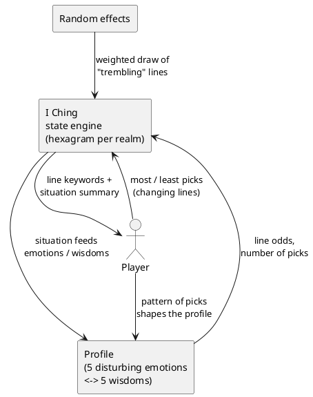
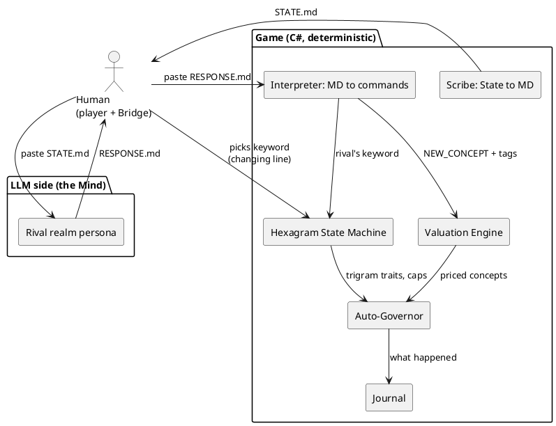
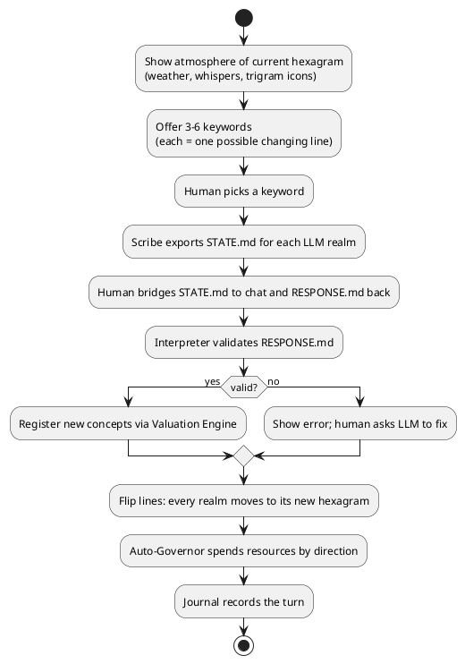

# SYNTROPY (repo: Flux) — Brainstorming Base

> Living document for the game-design brainstorming. **No implementation code** until the user says so.
> Source of everything marked *canon*: the original Perplexity brainstorming session (undated, pre-2026-11). The raw transcript was deleted on 2026-11-17; **this document is now the canon**.
> Each session: read this file → work one agenda item → update §3 Decisions, §5 Questions, §8 Log.

---

## 1. Vision (one breath)

A turn-based, top-down, tribe-to-civilization game where **nobody wins**. The goal is the **flow state** of whoever plays (and of whoever builds it). Evolution is **social and mental, not biological**. The world state is an **I Ching hexagram**: each turn a *changing line*, picked through plain-language keywords, moves the realm into a new hexagram. LLMs play the other realms, and they also **invent new concepts** (technologies, customs). The game's own deterministic laws put a price on everything they invent.

Philosophy underneath: *everything is one mind's appearance, so everything is good.* No ego-feeding, no monetization pressure. The builder's reward is the flow of building it.

## 2. Pillars

| # | Pillar | One-line meaning |
|---|---|---|
| P1 | **Communication** | Knowledge travels and distorts; it is not broadcast. |
| P2 | **Evolution** | Social/mental/cultural patterns unfold; extremes flip into their opposites. |
| P3 | **Feedback** | Choices echo across generations (trauma, learning, cultural memory). |
| P4 | **Strength in cooperation** | Alone is slow; together is fast but costs coordination. |
| P5 | **Flow** *(meta-pillar)* | Every mechanic is judged by whether it helps or breaks flow. |

## 3. Settled decisions (canon)

| ID | Decision | Notes |
|---|---|---|
| D-01 | Turn-based, top-down map, human tribe → civilization. | Civ is the reference genre, not a template. |
| D-02 | No winning. Emergence and a **Journal** (auto-chronicle) take its place. | Revised 2026-11-17: there **is** one fail condition, see D-19. |
| D-03 | Evolution is social/mental, not biological. **Religion is emergent, not a menu item**: no built-in religion mechanic, but belief systems may emerge from concepts. | Revised 2026-11-17. Rationale: in Civ every religion is the same buff package with a different name. What really moves people is the **ego illusion**; religion is one of its group-scale forms. See D-16, Q-21. |
| D-04 | Engine: **Unity C#**, Windows first, Android tablet maybe later. | Repo `CLAUDE.md` still describes a .NET WinForms *JobTracker*; it needs replacing before Phase 3 (implementation). |
| D-05 | **LLM players** via Markdown: game emits `STATE.md`, LLM returns `RESPONSE.md`. | |
| D-06 | **Manual Bridge** first: the human copy-pastes/drag-drops between game and chat. No API. | Bridge = ritual. |
| D-07 | LLM rules live in a doc set: `SYSTEM_CORE.md`, `PROTOCOL_RESPONSE.md`, `WORLD_LOGIC.md`, `EVOLUTION_LIBRARY.md`. | |
| D-08 | **I Ching hexagram = realm state.** Every realm has one. Player picks the changing line via keywords ("Choice of Fate"). | Player never needs to know it's I Ching. |
| D-09 | **Trigrams = passive buffs** (upper + lower trigram → two traits). | |
| D-10 | Determinism is **fractal**: same rules at every scale; same choice → same hexagram. | Refined by D-20, D-21: the *rules* are deterministic, the *dice* are not (outside tests). |
| D-11 | Four resources: **Material, Wealth, Knowledge, Culture.** | |
| D-12 | **Valuation Engine** (C#, deterministic) prices LLM-invented concepts from their **tags**; LLM never sets costs. | Balance stays in code. |
| D-13 | **Auto-Governor** executes the micro-management (builds, improvements) based on the chosen keyword/direction. | "Gardener" play style. |
| D-14 | Name: **SYNTROPY: Order from Chaos.** | Repo is called *Flux*, which was the runner-up name. |
| D-15 | **RPG elements are back in.** They were in the original request and dropped silently during the I Ching / Auto-Governor sessions. | 2026-11-17. *What* RPG means here is still open: Q-22. |
| D-16 | The **ego illusion** (sense of a separate self) is a core driving force of people in the game, stronger than religion. | 2026-11-17. How it becomes a mechanic: Q-21. |
| D-17 | The ego illusion shows up as **disturbing emotions**, at the individual level *and* at the group level (**group disturbing emotions**, the user's term). They are the **main antagonist force against cooperation (P4)**. | 2026-11-17. **Never named in the game**: the player only sees the emergent phenomena (feuds, hoarding, dogma, refusing a neighbour's know-how). Candidate set and transformation: Q-23. |
| D-18 | **Institutions are wisdom deflected by ego, not institutionalized poison.** Every force (army, trade, law, belief) has a wise core; the individual/group ego gives it a ricochet. Example: an army's core is peace-keeping (deterrence, balance of power, cf. the Cold War); deflected, it becomes conquest. | 2026-11-17. Explicitly **against** David Loy's reading (§8). The poison is a **raw material the player uses**, not an enemy to eliminate. |
| D-19 | **Fail condition: monopolization.** The weak get swept away and the remaining superpower turns dictatorial/monopolistic. The player's job is to decide how to use the poison: let monopolization happen, or keep it in check. | 2026-11-17. Fits Carse: the infinite game only "ends" when someone wins it. **Not a game over** (Q-24 → B, 2026-11-17): the hegemon falls into a heavy **Standstill** state (hexagram 12 as candidate) that can only be left through **collapse**, as empires do. The game continues after the fall. |
| D-20 | **"Same seed + same choices (+ same stored LLM responses) = same run"** holds for **testing/replay only**. The real game may be random (fresh seed). | 2026-11-17. The engine must still *support* a fixed seed so tests and bug replays are exact. Links Q-17. |
| D-21 | **Hexagram changes are weighted, not uniform.** The situation raises the odds of certain hexagrams (e.g. dictatorship/monopoly → Standstill). Changing lines may be random **and/or** chosen by the player. | 2026-11-17. Mechanism still open: Q-26. |
| D-22 | **Choice of Fate, v2:** the player receives the hexagram as **line keywords + a situation summary**, and picks several of them in a **"most / least" (DISC-like forced choice)** way. **How many** they may pick depends on **flexibility stats**. | 2026-11-17. Working reading: "most" = that line changes, "least" = that line is held this turn. Supersedes the "pick one keyword" loop in §4. |
| D-23 | **Hidden profile from choices.** The pattern of the player's picks builds a profile the player never sees as numbers. The profile feeds back: it influences **how many changing lines** can be chosen (and possibly the line odds of D-21). | 2026-11-17. Strong RPG link (Q-22). Dimensions and feedback balance: Q-27. |
| D-24 | **The core formula.** (1) The **I Ching** is the game's **state engine**: non-negotiable. (2) The **disturbing emotions / wisdoms** form the **player profile**. (3) The game *is* the **interplay of these two + random effects + player interaction**. | 2026-11-17. Answers the axes part of Q-27: profile = 5 disturbing emotions ↔ 5 wisdoms. Everything else (resources, Valuation Engine, Auto-Governor, LLM realms) serves this core. See §4 "Core engine". |

## 4. Core model (as understood so far)

### Core engine (D-24, 2026-11-17)

### Who decides what (earlier LLM-centric view)

One turn, as it was envisioned:

## 5. Open questions & tensions

Grouped by the session that should resolve them (§7). **Bold** = blocks other decisions.

### Player & loop
- **Q-01 Who is the human?** A catalyst/meme inside the society (session 1), the ruler of one realm picking keywords (I Ching sessions), or the "Bridge" serving the LLMs? Possibly all three. If so, which one is the *main* experience?
- **Q-02 Does the human play by the same interface as the LLMs?** Symmetry idea: humans pick keywords in the UI, LLMs pick keywords in the MD. One state machine, two kinds of minds.
- Q-03 Flow needs *clear goals + immediate feedback*. Without winning, what is the per-turn and per-era "goal-shaped thing"? (Journal milestones? Discovering all 64 hexagrams? Self-set intentions?)
- Q-04 Does the per-turn copy-paste **feed** flow (ritual) or **break** it (chore)? At what turn count does it become a chore?

### I Ching mechanic
- **Q-05 Turn granularity:** does the hexagram change every turn, every era, or only on a keyword choice?
- **Q-26 How does the weighting work (D-21)?** Candidate pipeline: *situation* (disturbing emotions, cooperation, monopoly) → per-line odds of becoming a changing line → random draw marks the "trembling" lines → player picks among them through keywords. Note: the traditional casting methods are already non-uniform (yarrow stalks vs. coins give different odds for old yin/old yang), so the odds are a natural tuning knob. Idea: in Standstill lines get "stuck" (low odds) while pressure builds; collapse = many lines changing at once. Open: what does "like the DISC test" mean for the player's choice (forced choice of most/least-fitting words?), and does the choice profile feed back into the weights?
- **Q-27 Profile feedback (D-22, D-23):** axes settled by D-24 (5 disturbing emotions ↔ 5 wisdoms). Is "flexibility" its own stat or derived from the profile (e.g. rigidity = ego)? Guard against a **rich-get-richer spiral** (flexible → more picks → more flexible; rigid → stuck): what counterforce (crisis, P2 flip)? Is the profile fractal (character / group / realm)?
- **Q-28 What are the "random effects" (D-24)?** Only the weighted line draw, or also world events (drought, flood, plague, a stranger arriving)? Are events themselves expressed as line pushes, so that everything still flows through the I Ching engine?
- Q-29 Do **LLM realms** have a profile too? Symmetry (Q-02) suggests yes: same engine, same profile, two kinds of minds.
- Q-06 How do realms' hexagrams **interact**? (Trade/war/contact pushing lines in the neighbour's hexagram.)
- Q-07 "Fractal": is there also a hexagram per **city / group / person**, not only per realm?
- Q-08 Keyword source: own phrasing derived from public-domain translations (e.g. Legge, 1882)? Some later translations are still under copyright.

### Evolution & concepts
- ~~Q-09 "No religion" vs. mythology/ritual as social evolution.~~ Resolved by D-03 (revised): religion may emerge, it is not a mechanic.
- **Q-21 Ego illusion as a mechanic:** what is it measured on (person / group / realm, fractal?), what does it drive (status, in-group vs. out-group, conflict, belief systems), and how does it dissolve? Does it link to the hexagram (e.g. yang-excess = ego inflation)?
- Q-10 What is the **tag vocabulary**? It *is* the real rulebook: the LLM can only invent what tags can express.
- Q-11 Can concepts **die, decay, or be forgotten** (entropy vs. syntropy)? That's the name of the game, after all.
- Q-12 Biological evolution is out. What remains of the session-1 "generations" idea? Do people age, and do generations exist at all?

### World, communication, cooperation
- **Q-23 Which disturbing emotions, and can they transform?** Candidate: the classic five (confusion, attachment/greed, anger, pride, jealousy), each with a group-scale symptom (dogma, hoarding, feud/war, chauvinism, rivalry/sabotage). In the Vajrayana view each one transforms into a wisdom, which fits "everything is good" and P2 (extremes flip). Is transformation a game event? What triggers it? Hidden variables vs. something the LLM sees in `STATE.md`?
- ~~Q-24 What happens at monopolization?~~ Resolved: (b) Standstill + collapse, see D-19.
- **Q-25 Mechanics of Standstill & collapse:** how long can a realm stay in Standstill, what builds the pressure (hidden disturbing emotions?), what does the collapse produce (successor realms, a dark age, lost concepts, cf. Q-11), and does the player play *through* it or watch it? Is monopoly measured per realm only, or fractally (a person, a guild, a belief monopolizing a group)? How does the player *see* it coming?
- **Q-22 What does "RPG" mean here?** Options: (a) the player *is* one character (hero/sage/catalyst) inside the society; (b) a cast of named characters with social roles, traits and growth (session 1); (c) both. Strongly coupled to Q-01, Q-07 (hexagram per person?) and Q-13.
- **Q-13 Does the map with units survive the pivot?** The Auto-Governor and keyword play suggest macro-only. P1 (diffusion, telephone-game distortion) needs space and agents.
- Q-14 Cooperation: is it emergent (session 2) or a mechanic with numbers (session 1: logarithmic group effect, overlapping coalitions)?
- Q-15 Are there conflict and combat at all? If yes, how does war "feel" in a no-lose game?

### LLM side
- Q-16 How many LLM realms? Can they talk to **each other** (diplomacy via MD messages bridged by the human)?
- Q-17 Determinism vs. LLM randomness: does a save store the LLM transcripts so a replay is exact?
- Q-18 Does the LLM also play the **narrator** (Journal prose), or only the rivals?

### Meta
- Q-19 Who is the audience: you alone (flow while building), a few friends, or the public? This sizes everything else.
- Q-20 What's the **smallest playable thing** that already produces flow? (Candidate: 1 human realm + 1 LLM realm, no map, 20 turns, hexagrams + 4 resources + Journal.)

## 6. Parked ideas (from earlier sessions, not yet accepted or rejected)

- Telephone-game distortion of information over distance; communication tech ladder (face-to-face → smoke → runners → writing).
- Overlapping coalitions; logarithmic group efficiency; collective-intelligence-only discoveries.
- Trauma & Learning: society reacts to events; political pendulum where extremes flip into their opposites. *(Note: this is literally an I Ching "old yang becomes yin" changing line. Strong link to D-08.)*
- Cultural memory: past eras limit or open present options.
- Meme evolution: ideas mutate as they spread.
- Emergence detector / pattern recognizer that names unique events.
- Simple element layer for the player (Stability / Momentum / Flow) over the 8 trigrams.
- Hexagram as diplomacy mood: AI realm in "Conflict" ignores gold.
- Art: minimalist, earth/pastel palette, "breathing" UI. Audio: generative ambient, silence allowed.
- Logo: a hexagram resolving from chaos to order, left to right.
- Old phase plans (Gantt) from the source session: Protocol Design → Unity Foundation → Evolution & Emergence → Refinement & Flow. They are implementation plans, so they're out of scope for now.

## 7. Session roadmap (proposal)

| # | Session | Resolves | Output |
|---|---|---|---|
| S1 | **Player role & the core loop** | Q-01..04, Q-19 | One-paragraph "what the player does" + loop diagram v2 |
| S2 | **The Hexagram engine** | Q-05..08 | Rules for lines, keywords, realm interaction, fractal scale |
| S3 | **Evolution & concept economy** | Q-09..12 | Tag vocabulary draft, decay rules, 4-resource roles |
| S4 | **World & cooperation** | Q-13..15 | Map yes/no; communication & cooperation model |
| S5 | **The LLM table** | Q-16..18 | Protocol principles (not syntax yet), persona list |
| S6 | **Feel** | — | Art/audio/UI mood board, the "turn ritual" |
| S7 | **First playable slice** | Q-20 | Scope of a paper/LLM prototype |

Cheap trick worth trying early (still no code): **play a paper prototype in chat**. Draw a hexagram with coins, offer keywords, let an LLM play the rival. One evening of that answers more of Q-01..05 than a week of debate.

## 8. Inspirations (to study, not to copy)

- **Books/ideas:** David Loy, *The Great Awakening: A Buddhist Social Theory* (2003): the three poisons as *institutionalized* group-level forces. Kept as a **counterpoint**: the user rejects it (D-18: institutions are wisdom deflected by ego); Csikszentmihalyi, *Flow*; James P. Carse, *Finite and Infinite Games* (the source of "the infinite game"); Prigogine & Stengers, *Order Out of Chaos* (heads-up: the subtitle nearly repeats this book title); Fantappiè's syntropy; Eno & Schmidt's *Oblique Strategies* (a card deck of cryptic prompts, the nearest relative of "keywords as fate").
- **Game patterns:** story generators that chronicle emergent history; minimalist choice-card games; non-violent, meditative builders; "social engineering" sliders in 4X games. Discuss which *patterns* we want, not which games.
- **Name check:** "Syntropy" is also a term in agriculture (syntropic farming) and may be used by other products. Search before committing.
- *HallucInc notes* (deleted 2026-11-17): a Reddit post (r/ClaudeAI, "I built a free browser game with Claude Code") on a CLAUDE.md and sub-agent setup for an AI-built game. **Where it overlaps with `CLAUDE.md`, `CLAUDE.md` wins** (start-of-session reading = "re-read `.doc/` at every phase"; gated milestones = the 4-phase workflow with a stop after each phase; commit cadence = "commit only when the user asks", not "after each change"). Only one non-overlapping idea is kept for implementation: "same seed + same choices = same run" as a never-break rule (cf. D-10, Q-17). Its sub-agent workflow is **rejected**: no sub-agents in this project.

## 9. Decision log (append-only, newest on top)

- **2026-11-17**: Core formula agreed (D-24): I Ching state engine × disturbing-emotions/wisdoms profile + random effects + player interaction. Core engine diagram added to §4. New questions Q-28, Q-29.
- **2026-11-17**: Choice of Fate v2: line keywords + situation summary, DISC-like most/least picks, count by flexibility (D-22). Hidden profile from choices feeds back into the pick count (D-23). Open: Q-27.
- **2026-11-17**: Same-seed rule limited to testing/replay; real game may be random (D-20). Hexagram changes weighted by situation, changing lines random and/or chosen (D-21). Mechanism in Q-26. HallucInc sub-agent workflow rejected.
- **2026-11-17**: Source files `Brain storming.md` and `HallucInc.md` deleted by the user; links removed, this document is the canon. HallucInc ideas that overlap `CLAUDE.md` are superseded by `CLAUDE.md`.
- **2026-11-17**: Q-24 resolved: monopolization leads to Standstill → collapse, not game over (D-19 updated). Follow-up mechanics in Q-25.
- **2026-11-17**: Institutions = wisdom deflected by ego (D-18, against Loy). Fail condition introduced: monopolization (D-19, D-02 revised). New question Q-24.
- **2026-11-17**: Disturbing emotions (individual + group) named as the main antagonist of cooperation, shown only through emergent phenomena (D-17). New question Q-23.
- **2026-11-17**: Big-picture walkthrough, station 1. RPG elements restored (D-15). Religion: emergent, not a mechanic (D-03 revised, Q-09 closed). Ego illusion named as a core driver (D-16). New questions Q-21, Q-22.
- **2026-11-17**: Base document created from the old brainstorming. Embedded PNG Gantt charts in the source replaced by PlantUML.
