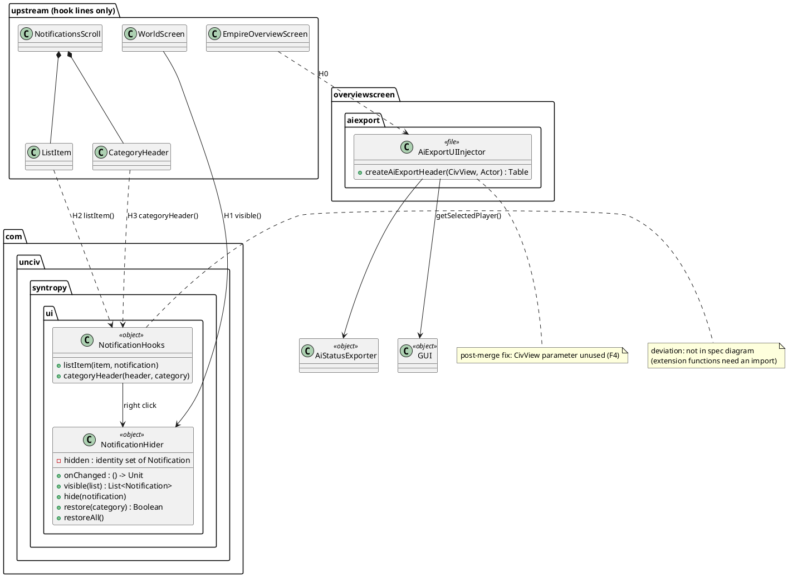
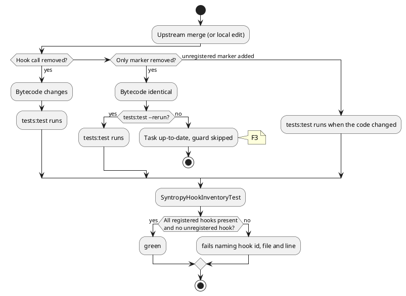

# review — Upstream hook minimization

Reviewed: `zzt_develop` @ `517f5649a` (pushed), against `spec.md` (incl. amendments) and upstream `origin/master` @ `f00881660`.
Feature commits: `c5849258b`, `1bd25483e`, `517f5649a` (+ doc-only ticks `fd0831345`, `d0364dd37`, `e9bbc6175`); upstream merge `80c6008fc`.

## 1. Summary & verdict

**Verdict: accepted, goal met.** The fork's footprint in upstream files is now **3 files, 4 lines**, all one-line, fully qualified and marked `// SYNTROPY-HOOK`:

| Hook | File | Diff vs. upstream |
|---|---|---|
| H0 | `ui/screens/overviewscreen/EmpireOverviewScreen.kt:70` | 1 changed line (wraps one argument) |
| H1 | `ui/screens/worldscreen/WorldScreen.kt:498` | 1 changed line (wraps one argument) |
| H2 | `ui/screens/worldscreen/NotificationsScroll.kt:414` | +1 line |
| H3 | `ui/screens/worldscreen/NotificationsScroll.kt:312` | +1 line |

Everything else is in new files (`com.unciv.syntropy.*`, `…/aiexport/*`, tests), which cannot conflict line-wise. Upstream `master` (1236 commits) merged without textual conflicts; one post-merge compile break in our own AI-export code was fixed without touching a hook line. GitHub now shows `zzt_develop` 57 ahead, 0 behind upstream.

Build & tests at review time: `./gradlew tests:test --rerun desktop:dist` → BUILD SUCCESSFUL, 1044 tests, 0 failures, 0 errors, 26 skipped (upstream `@Ignore`s). Manual game check after the merge: all OK (user, 2026-11-18). `desktop:dist` was up-to-date (jar from 22:30) because `core` has not changed since the post-merge fix; only tests changed in T9–T10.

## 2. Spec compliance checklist

| Spec item | Status | Note |
|---|---|---|
| §1 conventions 1–5 (add-only, one line, FQN, marker, call-site preference) | ✅ | H1 and H0 wrap an argument (allowed by convention 1); no upstream imports added. |
| §1 convention 6 (register every hook) | ✅ | Enforced by `SyntropyHookInventoryTest`. |
| §2 affected files | ✅ with deviations | `NotificationHooks.kt` added (amendment T2); `AiExportUIInjector.kt`, `AiStatusExporter.kt` and `AiExportWiringTest.kt` changed by the post-merge fix (not in §2, see F1). |
| §3 `NotificationHider` API | ✅ | Identity-based set, `onChanged`, `visible` returns the same instance when nothing is hidden, `hide`, `restore`, `restoreAll`. |
| §3 H1–H3 | ✅ with deviation | H2/H3 call `NotificationHooks`, not `onRightClick { NotificationHider… }` directly (amendment T2: extension functions cannot be called by FQN). |
| §3 behaviour changes (restore on header right click; fully hidden category disappears; restore count) | ✅ | Confirmed in the game. Right click is also long press on mobile (`ActivationTypes.Longpress` ≙ `RightClick`). |
| §4 edge cases | ✅ | Purge on new list; render-thread only; one-time-notification edge accepted as specified. |
| §5 unit tests (6 cases) | ✅ | `NotificationHiderTest` 6/6. |
| §5 surface check "git grep lists exactly H0–H3" | ⚠️ superseded | Plain grep finds 6 lines (2 KDoc mentions). Superseded by the end-of-line marker rule in §7, enforced by the inventory test. |
| §5 merge order | ✅ with finding | Followed; the `merge-tree` dry run missed a compile break (F2). |
| §7 inventory test (3 tests, source-root resolution, negative checks) | ✅ | 3/3 green; both negative checks failed with the expected messages. |
| §7 removal of `AiExportWiringTest` | ✅ | No references left. |

## 3. Findings

| # | Severity | Finding | Recommendation |
|---|---|---|---|
| F1 | Medium (process) | **Upstream API changes break our own code behind a hook, not the hook itself.** The merge broke `AiStatusExporter` (`isSpectator()` → property) and the H0 call (`Civilization` → `CivView`, view layer #15280). The fix kept the hook line unchanged, which is exactly the benefit of the design, but it was not anticipated in the spec. Upstream is actively moving UI to `com.unciv.view.*`, so more of this is likely. | Expect a compile-fix step after every upstream merge; keep our code depending on as few upstream types as possible. |
| F2 | Medium (process) | **The T5 dry run (`git merge-tree`) only detects textual conflicts.** It reported a clean merge, yet `core` did not compile afterwards. | Make "dry-run merge" = `merge-tree` **plus** compile and test of the merged tree, e.g. in a throw-away `git worktree`, before merging into `zzt_develop`. |
| F3 | Low | **Gradle incremental-build gap in the hook guard.** If only the `// SYNTROPY-HOOK` marker disappears (the call stays), compiled classes are identical, `tests:test` is up-to-date, and `SyntropyHookInventoryTest` does not run. Found during T9 negative check (a). A lost hook *call* changes bytecode and is caught. | Either accept (low risk), or declare `core/src` as an input of `tests:test` in `tests/build.gradle.kts`. That is one more upstream hook (build file), so it would need registering; or always run `tests:test --rerun` after upstream merges (cheapest; add to the merge checklist). |
| F4 | Low | **`createAiExportHeader` ignores its `CivView` parameter** (`@Suppress("UNUSED_PARAMETER")`) and exports `GUI.getSelectedPlayer()`. Correct for today's two call sites (both pass `selectedGameView.civView`), but if upstream ever opens the overview for another civ, the report would silently describe the wrong civ. | Compare `viewingPlayer.civName` with the selected civ's `civName`; on mismatch log and show a toast instead of exporting. Small, in our own file. |
| F5 | Low | **Right click on a category header with nothing hidden** plays the click sound but does nothing (`onRightClick` default sound). | Optional: pass `UncivSound.Silent` and play the sound only when `restore` returned true. Cosmetic. |
| F6 | Low | **`NotificationHooks` has no unit test.** It is two one-line listener attachments, covered by the manual check. | Accept; a Gdx actor test would cost more than it guards. |
| F7 | Info | **Spec diagrams are outdated:** the class diagram has `ListItem`/`CategoryHeader` → `NotificationHider` directly and lacks `NotificationHooks`, H0 and the inventory test. | As-built diagrams below; spec left as the historical agreement. |
| F8 | Info | **Project instructions are not versioned.** `CLAUDE.md` is excluded via `.git/info/exclude`, `.claude/` via upstream `.gitignore`. The hook conventions now live only in this feature's `spec.md`. `.doc/context_state.md`, referenced by `CLAUDE.md`, does not exist. | Promote the hook conventions (spec §1, 1–6) and the merge checklist (F2, F3) to a durable place: D-43 in the brainstorming doc and/or `CLAUDE.md`; decide whether `CLAUDE.md` should be tracked; create `context_state.md` or drop the reference. |

No logic errors, memory leaks or thread-safety issues found:
- `NotificationHider.hidden` is bounded by the current notification list (purged on every `visible()` call) and holds no screen or stage references.
- Listeners are attached to actors that are rebuilt on each `updateContent`, so they do not accumulate.

## 4. Recommended follow-ups

1. **Upstream merge checklist** (F2, F3), documented next to D-43:
   1. `git fetch` upstream.
   2. Dry run: `merge-tree`, then build and test in a throw-away worktree.
   3. Merge.
   4. `tests:test --rerun` and `desktop:dist`.
   5. Manual check of the hooked features.
2. **F4 guard** in `AiExportUIInjector` (small, own file).
3. **F8**: move the hook conventions into D-43 / `CLAUDE.md`; decide about tracking `CLAUDE.md`.
4. Optional: F5 (sound), F3 (Gradle input).
5. Housekeeping:
   - delete `feature/upstream-hook-minimization` (fully contained in `zzt_develop`);
   - delete the local ref `refs/tmp/upstream-master`.

## 5. `.doc/context_state.md`

Does not exist (see F8). No architecture diagram to update. If it is created, it should show the `com.unciv.syntropy` package and the hook boundary (diagram 1 below).

## 6. As-built diagrams

