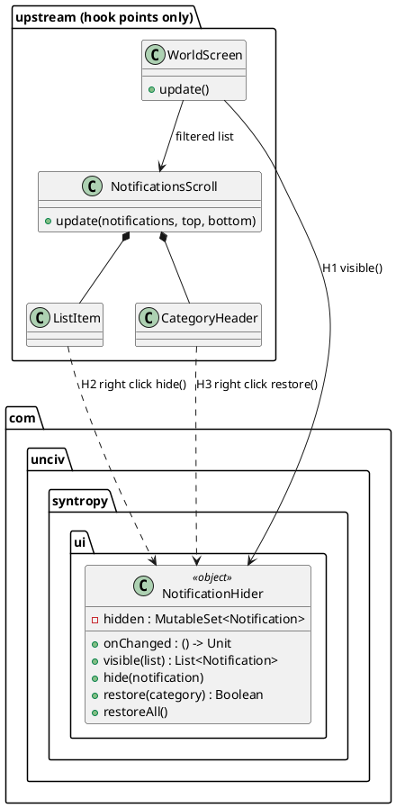
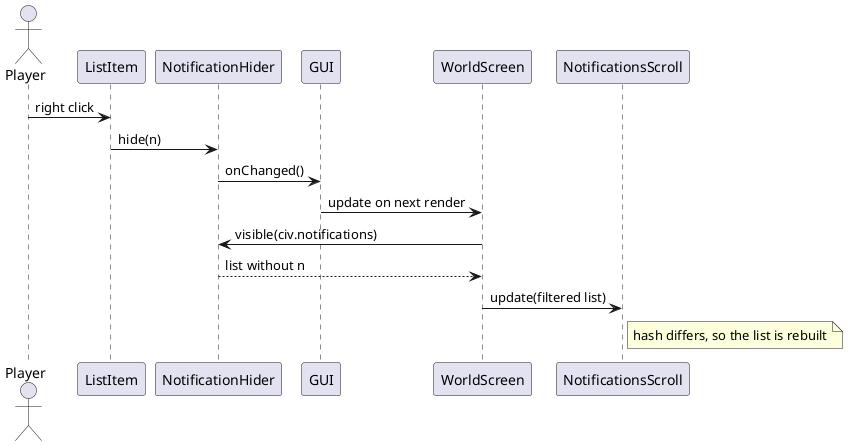

# spec — Upstream hook minimization

## 1. Context & Goal

Syncing the fork with `yairm210/Unciv:master` conflicts in `NotificationsScroll.kt`. Our "hide notification on right click" feature edits that upstream file in five places (import, field, hash line, category loop, header `onClick`, item `onRightClick`), two of which rewrite upstream lines that upstream has since refactored.

Goal: shrink the fork's footprint in upstream files to **add-only, one-line, marked hook points**, and move all logic and state into our own package (D-43). Then merge upstream `master` with no conflicts.

Scope:
- In scope: the notification-hide feature (`NotificationsScroll.kt`, `NotificationsScrollExtensions.kt`, the `WorldScreen.kt` call site); a marker comment on the existing `EmpireOverviewScreen.kt` hook; the hook conventions below; the merge of upstream `master` (`f00881660` or newer) into `zzt_develop`.
- Out of scope: moving the AI-export files (`...overviewscreen/aiexport/`, `...logic/civilization/aiexport/`) into the `syntropy` package. They are new files, not edits, so they cannot conflict line-wise; moving them is churn without merge benefit.

### Hook conventions (apply to every future fork change)

1. **Add lines, never rewrite upstream lines.** If an expression must change, wrap it in a single call instead of editing its internals.
2. **One line per hook point**, calling into our own package. All state and logic live there.
3. **Fully qualified names, no new imports.** Upstream import blocks change often and conflict easily.
4. **Mark every hook** with a trailing `// SYNTROPY-HOOK` comment, so `git grep SYNTROPY-HOOK` lists the whole upstream surface.
5. Prefer hooking at **call sites** (data passed in) over the inside of upstream classes.

## 2. Affected Files

| Action | Path |
|---|---|
| create | `core/src/com/unciv/syntropy/ui/NotificationHider.kt` |
| create (added in T2) | `core/src/com/unciv/syntropy/ui/NotificationHooks.kt` |
| create | `tests/src/com/unciv/testing/syntropy/NotificationHiderTest.kt` |
| delete | `core/src/com/unciv/ui/screens/worldscreen/NotificationsScrollExtensions.kt` |
| modify (revert to upstream + 2 hook lines) | `core/src/com/unciv/ui/screens/worldscreen/NotificationsScroll.kt` |
| modify (wrap 1 argument) | `core/src/com/unciv/ui/screens/worldscreen/WorldScreen.kt` (the `notificationsScroll.update(viewingCiv.notifications, …)` call) |
| modify (add marker comment only) | `core/src/com/unciv/ui/screens/overviewscreen/EmpireOverviewScreen.kt` |

## 3. Architecture & Data Flow

### `NotificationHider` (object, package `com.unciv.syntropy.ui`)

Single owner of the hidden-notification state. No Gdx types in its API.

- `private val hidden: MutableSet<Notification>`: identity-based (`Notification` has no equality contract, upstream relies on `===`).
- `var onChanged: () -> Unit`: defaults to `{ GUI.setUpdateWorldOnNextRender() }`; tests replace it with a no-op or a counter.
- `fun visible(notifications: List<Notification>): List<Notification>`: drops stale entries (`hidden.retainAll(notifications)`), then returns the notifications not in `hidden`. Returns the **same list instance** when nothing is hidden, so behaviour and allocation are unchanged for players who never hide anything.
- `fun hide(notification: Notification)`: adds it, calls `onChanged`.
- `fun restore(category: Notification.NotificationCategory): Boolean`: removes all hidden of that category; calls `onChanged` and returns `true` if any were removed.
- `fun restoreAll()`: clears; calls `onChanged` if anything was hidden. (Used by tests and available to a later UI.)

### Hook points (the complete upstream surface for this feature)

| # | File | Hook | Kind |
|---|---|---|---|
| H1 | `WorldScreen.kt` | first argument of `notificationsScroll.update(...)` becomes `com.unciv.syntropy.ui.NotificationHider.visible(viewingCiv.notifications)` | wrap one argument |
| H2 | `NotificationsScroll.kt`, `ListItem.init` | new line after the existing `onClick { … }` block: `com.unciv.syntropy.ui.NotificationHooks.listItem(this, notification)` | add line |
| H3 | `NotificationsScroll.kt`, `updateContent` category loop | new line after the existing `header?.onClick { … }` block: `com.unciv.syntropy.ui.NotificationHooks.categoryHeader(header, category)` | add line |

Amendment (T2): `onRightClick` is a Kotlin extension function, which cannot be called with a fully qualified name, so a direct `header?.onRightClick { … }` would need an upstream import (convention 3). H2/H3 therefore call `NotificationHooks` (object, same package), which attaches the right-click listeners and delegates to `NotificationHider.hide` / `restore`. This also keeps `NotificationHider`'s API free of Gdx types.
| H0 | `EmpireOverviewScreen.kt` | existing `createAiExportHeader` line gets the `// SYNTROPY-HOOK` marker | comment only |

Why H1 replaces three of today's edits: the scroll receives an already-filtered list, so
- the category loop needs no filter;
- the change-detection hash changes on its own (a different list has a different `hashCode()`), so the custom hash function goes away;
- stale cleanup happens in `visible()`.

### Behaviour changes vs. today

- **Restore moves from header left-click to header right-click.** Left-click on a header keeps upstream's collapse/expand untouched. (Today a left-click restores if anything is hidden, otherwise collapses: an overloaded gesture that also forced us to rewrite the upstream `onClick`.)
- **A fully hidden category disappears with its header** until a notification of that category arrives again or the turn changes (notifications are rebuilt each turn, `visible()` drops the stale ones). Recovery path: Empire Overview → Notifications tab still lists everything, because it reads `viewingCiv.notifications` directly, not through H1.
- The restore button's count shows only visible notifications (it receives the filtered list). Accepted: it counts what the scroll would show.

### SOLID notes

- SRP: hiding policy lives in one object; `NotificationsScroll` stays a pure renderer of the list it is given.
- OCP/DIP: the scroll does not know the hider; it only exposes upstream's `ListItem`/header actors to a one-line listener. `onChanged` decouples the hider from `GUI` for tests.

## 4. Edge Cases & Risks

- **Identity vs. equality:** `Notification` uses reference equality. If upstream ever adds `equals`/`hashCode`, two identical-looking notifications would hide together. Acceptable; documented in the KDoc.
- **New game / load game / civ switch (hotseat):** the old notification objects are not in the new list, so the first `visible()` call purges them. No leak beyond one list's worth of references in between.
- **Memory:** `hidden` is bounded by the current notification list through `retainAll`; a global object holds no screen or stage reference.
- **Hiding the highlighted / one-time notification:** upstream re-adds `oneTimeNotification` via `additionalNotification` inside the scroll, after H1. A hidden notification that is also the one-time one may therefore stay visible until deselected. Accepted (same as today's visible-but-hidden edge); noted, not fixed.
- **Threading:** all calls come from the Gdx render thread (`WorldScreen.update`, input listeners). No synchronisation needed; KDoc states "render thread only".
- **Hotseat privacy:** hidden state is shared across human players on one device; harmless because each player's list purges the other's entries.
- **Merge risk:** H2/H3 are added lines next to upstream blocks. A conflict is still possible if upstream edits the adjacent `onClick` blocks, but resolution is then trivial (keep theirs, re-add one line).

## 5. Verification Strategy

Unit tests, `NotificationHiderTest` (JUnit 4, `GdxTestRunner` not required; `onChanged` replaced by a counter):
1. `visible` with nothing hidden returns the same list instance.
2. `hide(a)` → `visible([a, b])` == `[b]`, `onChanged` called once.
3. `hide(a)` then `visible([b])` (a gone) → `a` is purged; a later `visible([a, b])` returns both (stale entry cleaned).
4. `restore(category)` returns `true` and un-hides only that category; second call returns `false` and does not call `onChanged`.
5. Identity: two distinct `Notification`s with the same text — hiding one does not hide the other.
6. `restoreAll()` clears and calls `onChanged` only if something was hidden.

Build / regression:
- `./gradlew tests:test` green, including existing `AiExportWiringTest` / `AiStatusExporterTest`.
- `./gradlew desktop:dist` builds.

Surface check (the actual goal):
- `git diff <upstream master> -- NotificationsScroll.kt` shows exactly 2 added lines (H2, H3) and nothing else.
- `git grep -n SYNTROPY-HOOK -- core` lists exactly H0–H3.
- Before merging upstream: `git merge-tree --write-tree` of the refactored `zzt_develop` against upstream `master` reports **no conflicts**.

Manual (desktop run): right-click a notification hides it; right-click its category header restores; left-click header still collapses/expands; Empire Overview → Notifications still shows hidden ones.

### Merge order

1. Branch `feature/upstream-hook-minimization` from `zzt_develop`; do the refactor on the **old** upstream base (H2/H3 placed in the old file at the same anchors).
2. Merge it into `zzt_develop`.
3. Sync `origin/master` with upstream (GitHub "Sync fork" on the `master` branch, a fast-forward).
4. Merge `master` into `zzt_develop`; expected conflict-free per the `merge-tree` check. Re-run tests after the merge.

## 6. Diagrams

